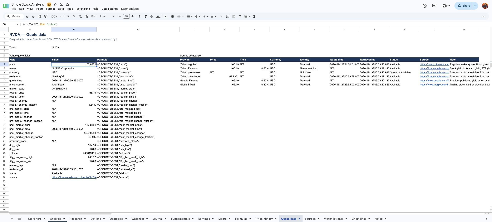

# TickerSheets

Open-source stock and options research for Google Sheets.

TickerSheets is our Google Sheets application for researching one stock, its options and economic context.
It creates analysis tabs, charts, earnings tables, a watchlist and reusable formulas in your spreadsheet's Apps Script project.
It requires no hosted server.

[View TickerSheet Demo and Tutorial](https://docs.google.com/spreadsheets/d/1HpA7L6hImHHaC7GECxYiBZpMvRiWTcMI5x1o10hDQ24/edit) or [make your own copy](https://docs.google.com/spreadsheets/d/1HpA7L6hImHHaC7GECxYiBZpMvRiWTcMI5x1o10hDQ24/copy).
The **TickerSheet Demo and Tutorial** workbook demonstrates one-ticker research tabs, charts, earnings, option chains and a watchlist.
You can also create your own spreadsheet with the same functions.

Open **Start here** in your copy to learn from the working formulas.
**Analysis!B9** contains `=CFQUOTE($B$4,"price")` and displays the returned price in that same cell.
**Quote data** and **Fundamentals** show individual field formulas beside their results.
For your own sheet, enter a ticker in `A1` and use `=CFQUOTE(A1,"price")` in another cell.
You can use these functions without the sample's tab layout.
History, earnings, option chains and economic histories return tables with a formula in the first cell.
**Price history** contains visible formulas for moving averages, RSI, MACD, returns and volatility.
Choose **Stock analysis → Refresh selected ticker** to request new results for the sample.
Google Sheets then recalculates the individual values, returned tables and their dependent formulas.

*NVDA example with saved results from November 12, 2026. Refresh your own copy to request newer data.*

| Guide | Purpose |
|---|---|
| [SAMPLE.md](SAMPLE.md) | Explore the sample spreadsheet and its controls, tabs and charts |
| [INSTALL.md](INSTALL.md) | Copy the template or install the script, authorize requests and save API keys |
| [FUNCTIONS.md](FUNCTIONS.md) | Find formula arguments, output columns, units, sources and limits |
| [BUILD-YOUR-OWN.md](BUILD-YOUR-OWN.md) | Create custom tabs with one ticker input and copyable formulas |
| [PROVIDERS.md](PROVIDERS.md) | Review data sources, API keys, dated results and testing instructions |

Quotes can include regular, pre-market and after-hours prices, each with its own timestamp.
Data updates when you request a refresh. The functions do not stream prices continuously.
Provider availability varies by ticker and field. The function reference explains the current limits.

## What works without API keys

**The public NVDA sample contains no saved API keys and does not use the author's private keys.**
You can view its saved example results without adding keys.
In your own copy, you can refresh these sources without personal provider keys:

| Source or feature | Available without a personal API key |
|---|---|
| Yahoo | Quotes, available pre-market/after-hours prices, daily history, fundamentals, earnings, published option expirations and option chains |
| Finviz, Zacks and GuruFocus | Selected Finviz fields, Zacks price targets and public GuruFocus dividend yields |
| Google Finance website and Globe & Mail | Comparison quotes, names and selected yields |
| Calculations and workbook tabs | Technical indicators, RSI2 targets, native charts, option models, strategy calculators, watchlists and journal entries from available data |
| Provider chart links | Links to chart pages that you open separately. The script does not download provider images. |

Google still requires authorization for the Apps Script project in your copy.
Provider access and returned fields can change. See [PROVIDERS.md](PROVIDERS.md) for tested fields and current limits.

## Make your own copy

1. Open the [sample copy link](https://docs.google.com/spreadsheets/d/1HpA7L6hImHHaC7GECxYiBZpMvRiWTcMI5x1o10hDQ24/copy) while signed in to your Google account.
2. Click **Make a copy**.
3. In your copy, choose **Stock analysis → Refresh selected ticker**.
4. Complete Google's authorization steps for your copy.
5. If the refresh does not run after authorization, choose **Refresh selected ticker** again.

If the menus are missing, reload your copy once.
Open **Start here** for a short walkthrough and examples you can trace with `FORMULATEXT`.
To analyze another stock, change **Analysis!B4**, then refresh the selected ticker.
The public sample stays read-only. You edit and refresh your own copy.

## Add your own API keys

You can add keys for these providers in your private copy:

| Provider | Features that require your key |
|---|---|
| FRED | Economic observations, exact-date lookups and economic charts |
| Finnhub, Alpha Vantage and Twelve Data | Optional quote lookups through `CACHEFINANCE` / `CACHEFINANCES` |
| CoinMarketCap | Optional cryptocurrency quote lookups through `CACHEFINANCE` / `CACHEFINANCES` |

Add only the keys for providers you want to use.
Without a FRED key, FRED values report that a key is required.
The stock and options features can still refresh.

1. Get your own API key from the provider. FRED's [API key page](https://fred.stlouisfed.org/docs/api/api_key.html) explains its requirements.
2. In your copy, choose **Data settings → API keys…**.
3. Enter the key in the matching provider field.
4. Click **Save keys**.
5. Check that the provider shows **Saved**.
6. For FRED, choose **Stock analysis → Refresh selected ticker** to load the economic data.

You do not need to open the Apps Script editor or put keys in worksheet cells or formulas.
Blank fields preserve saved keys, and the form never displays saved key values.
**Saved** confirms storage. It does not confirm that the provider accepts the key.
The script stores keys in your copy's Apps Script project.
Other editors of that spreadsheet can access its script and keys, so keep copies with personal keys private.

For the other keyed providers, see the [quote lookup formulas](FUNCTIONS.md#original-cachefinance-and-cachefinances).
See [INSTALL.md](INSTALL.md#save-api-keys) for detailed setup and the [blank-sidebar workaround](INSTALL.md#if-the-sidebar-is-blank).

## Acknowledgments

This application builds on [CacheFinance](https://github.com/demmings/cachefinance), which supplies the original caching functions and quote adapters.
See [UPSTREAM.md](UPSTREAM.md) for its attribution and preserved reference documentation.

We also used ideas from [SMF (Stock Market Functions)](https://climbermel.github.io/SMF_Add-in/) for provider lookups, research formulas and example workbooks.
SMF is an Excel add-in that retrieves web data into spreadsheet cells.
