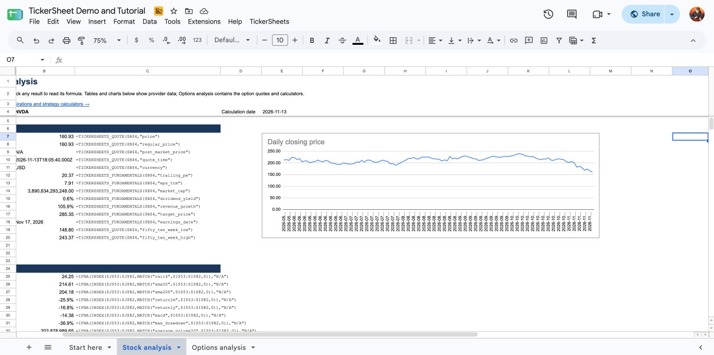

# TickerSheets

Stock and options research in Google Sheets, with formulas you can reuse in your own spreadsheets.
Get quotes, company financials, earnings, price history and option chains.
Everything runs in Apps Script in your Google account. There is no hosted server.

`GOOGLEFINANCE` provides basic quotes and price history.
We wanted option chains, expiration dates, earnings history and more detailed company data, so TickerSheets uses other providers.
It also fetches history directly because [Google prevents Apps Script from reading `GOOGLEFINANCE` historical results](https://support.google.com/docs/answer/3093281?hl=en).

For example, this formula returns Apple's latest available price:

```excel
=TICKERSHEETS_QUOTE("AAPL","price")
```

## Start with the example spreadsheet

[View the example spreadsheet](https://docs.google.com/spreadsheets/d/1HpA7L6hImHHaC7GECxYiBZpMvRiWTcMI5x1o10hDQ24/edit) to explore the saved stock and options analysis.

The public example is read-only and has no API keys.
[Make your own copy](https://docs.google.com/spreadsheets/d/1HpA7L6hImHHaC7GECxYiBZpMvRiWTcMI5x1o10hDQ24/copy) to change the ticker, refresh data or add your own keys.
Google includes the required script with the copy.

To use TickerSheets in a spreadsheet you already have, follow [Add TickerSheets to an existing spreadsheet](GUIDE.md#add-tickersheets-to-an-existing-spreadsheet).



## Documentation

- [User guide](GUIDE.md) — setup, the example spreadsheet, formula recipes, API keys and troubleshooting.
- [Function reference](FUNCTIONS.md) — every function, its arguments, data source, API-key requirement and limits.

## API keys and data

Yahoo stock and options data and selected Finviz, Zacks and GuruFocus fields need no personal API key.
FRED and quotes from Finnhub, Alpha Vantage, Twelve Data and CoinMarketCap require your own keys.
See [Save API keys](GUIDE.md#save-api-keys).

Provider data can be delayed or unavailable. Prices do not stream continuously.
See [data sources](FUNCTIONS.md#data-sources) for provider details.

## Credits

TickerSheets started with [CacheFinance](https://github.com/demmings/cachefinance), which showed us what was possible in Google Sheets.
[SMF](https://github.com/ClimberMel/SMF_Add-in) inspired many of the functions and examples.
Thank you to both projects and their contributors.
See [credits](CREDITS.md) and the [GPL v3 license](LICENSE).

For code changes and tests, see [Contributing](CONTRIBUTING.md).
