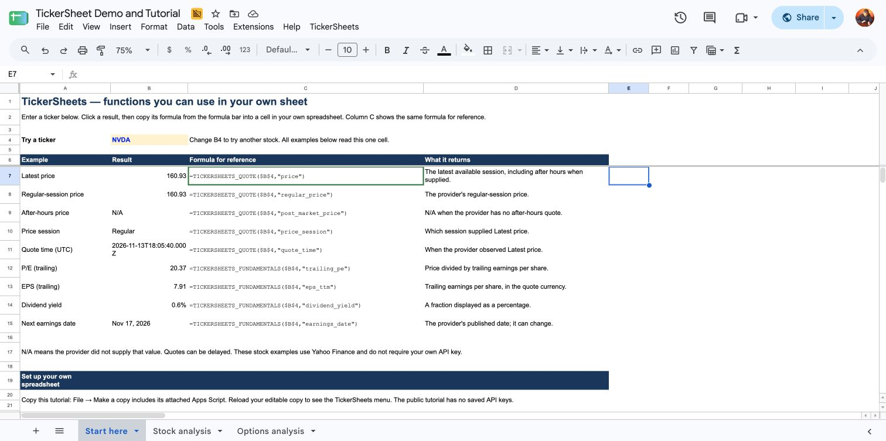
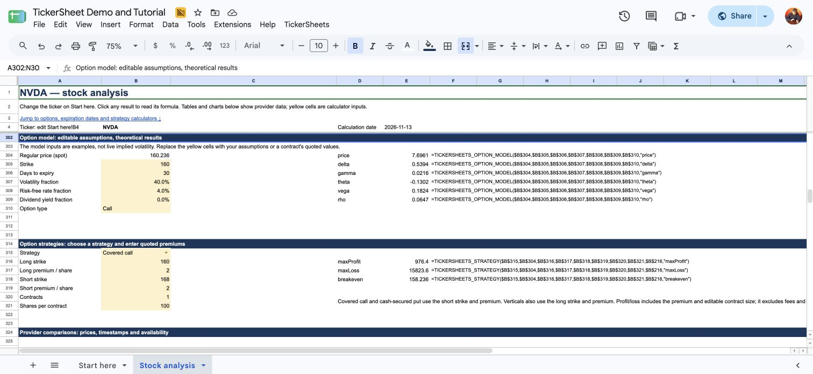

# TickerSheets

Reusable stock and options functions for Google Sheets.

Example:

```excel
=TICKERSHEETS_QUOTE("AAPL","price")
```

Other functions return fundamentals, earnings, daily history, option chains, RSI2 targets and FRED observations.
Everything runs in the spreadsheet's attached Apps Script. There is no hosted server.
TickerSheets is an independently maintained project with its own function API and provider requests.
The implementation was developed with substantial AI assistance and would benefit from wider testing and code review.

## Get started

Choose one installation method:

1. [Copy TickerSheet Demo and Tutorial](https://docs.google.com/spreadsheets/d/1HpA7L6hImHHaC7GECxYiBZpMvRiWTcMI5x1o10hDQ24/copy). Google copies its attached Apps Script too.
2. For your own spreadsheet, add a `TickerSheets` script file under **Extensions → Apps Script**, then paste [dist/TickerSheets.js](https://github.com/dnarain/tickersheets/blob/main/dist/TickerSheets.js) into it. Save and reload the spreadsheet.

Then enter the functions in the cells where you want their results.
The demo has three tabs. **Start here** teaches simple formulas beside their results.
**Stock analysis** shows quotes, company fields, earnings, technical indicators and a price chart.
**Options analysis** shows expiration dates, call/put quotes, model Greeks, strategy calculations and a payoff chart.
All three tabs use the ticker in **Start here!B4**.
You can [view the public tutorial](https://docs.google.com/spreadsheets/d/1HpA7L6hImHHaC7GECxYiBZpMvRiWTcMI5x1o10hDQ24/edit) without copying it.

[](https://docs.google.com/spreadsheets/d/1HpA7L6hImHHaC7GECxYiBZpMvRiWTcMI5x1o10hDQ24/edit)

*Tutorial with copyable formulas.*

[](https://docs.google.com/spreadsheets/d/1HpA7L6hImHHaC7GECxYiBZpMvRiWTcMI5x1o10hDQ24/edit)

*Stock analysis with company fields, technical indicators and a closing-price chart.*

| What you want | Formula with the ticker in A1 |
|---|---|
| Latest available price | `=TICKERSHEETS_QUOTE(A1,"price")` |
| Regular-session price | `=TICKERSHEETS_QUOTE(A1,"regular_price")` |
| After-hours price | `=TICKERSHEETS_QUOTE(A1,"post_market_price")` |
| Trailing P/E | `=TICKERSHEETS_FUNDAMENTALS(A1,"trailing_pe")` |
| Trailing EPS | `=TICKERSHEETS_FUNDAMENTALS(A1,"eps_ttm")` |
| Daily history | `=TICKERSHEETS_HISTORY(A1,252)` |
| Option expiration dates | `=TICKERSHEETS_EXPIRATIONS(A1)` |
| Nearest-expiration option chain | `=TICKERSHEETS_OPTIONS(A1)` |

A named field returns one value in its formula's cell.
History and option functions return tables that expand into adjacent empty cells.
The functions can reuse recent cached provider responses. They do not stream continuously.
Choose **TickerSheets → Refresh data** to request new results from your installed functions.

## Options research

Use `TICKERSHEETS_EXPIRATIONS` to list published dates and `TICKERSHEETS_OPTIONS` to request a chain for a chosen expiration.
The chain includes call/put type, strikes, bid, ask, last price, implied volatility, volume and open interest.
The **Options analysis** tab combines those quotes with an option model and strategy calculators.

`TICKERSHEETS_OPTION_MODEL` calculates a theoretical premium, delta, gamma, theta, vega and rho from your assumptions.
Those calculated values are separate from the provider's market quotes.
`TICKERSHEETS_STRATEGY` calculates covered-call, cash-secured-put and call/put vertical results and expiration payoff.
See [FUNCTIONS.md](FUNCTIONS.md#tickersheets_expirations-and-tickersheets_options) for chain columns and [the model reference](FUNCTIONS.md#tickersheets_option_model) for units and limits.

[](https://docs.google.com/spreadsheets/d/1HpA7L6hImHHaC7GECxYiBZpMvRiWTcMI5x1o10hDQ24/edit#gid=1492408701&range=A96)

*Editable assumptions, model Greeks and strategy results, with each formula visible beside its result.*

## API keys

**The public tutorial does not contain any API keys.**
Yahoo stock quotes, history, fundamentals, earnings and public option chains do not require a personal key.
Selected Finviz, Zacks and GuruFocus fields also use public pages.

The key form supports **Finnhub**, **Alpha Vantage**, **Twelve Data**, **CoinMarketCap** and **FRED**.
Choose **TickerSheets → API keys…**, enter your own keys in the matching fields, then click **Save keys**.
FRED functions require a FRED key.
`TICKERSHEETS_PROVIDER_QUOTE` requests quotes from a selected keyed provider, such as:

```excel
=TICKERSHEETS_PROVIDER_QUOTE(A1,"FINNHUB","price")
```

This formula requires your own Finnhub key. It does not change the source used by `TICKERSHEETS_QUOTE`.
Keyed-provider access depends on your key, plan and symbol permissions.

Blank fields preserve saved keys. The form shows saved-status labels without revealing saved key values.
Keys stay in the attached Apps Script project's Script Properties.
Other editors of your spreadsheet can access its script and keys, so keep a copy with personal keys private.
Do not put keys in worksheet cells, formulas or GitHub reports.

If the menu is missing, reload your editable copy.
See [INSTALL.md](INSTALL.md) for authorization and the [blank-sidebar workaround](INSTALL.md#if-the-sidebar-is-blank).

## Guides

| Guide | Purpose |
|---|---|
| [INSTALL.md](INSTALL.md) | Copy the tutorial or install the functions in your own spreadsheet |
| [SAMPLE.md](SAMPLE.md) | Learn from the tutorial, stock analysis and options analysis |
| [FUNCTIONS.md](FUNCTIONS.md) | Find every function, argument, supported field, unit and limit |
| [BUILD-YOUR-OWN.md](BUILD-YOUR-OWN.md) | Copy simple formulas into your own worksheet |
| [PROVIDERS.md](PROVIDERS.md) | Review sources and dated provider checks |

Provider availability varies by ticker and field.
The function reference explains missing results, timestamps and current limits.

## Where TickerSheets started

TickerSheets started with [CacheFinance](https://github.com/demmings/cachefinance).
Thank you to its author and contributors for sharing code that we could learn from and extend.
Their work showed us what was possible inside Google Sheets and gave this project its starting point.

We found that Google's `GOOGLEFINANCE` data did not cover the research we wanted to do.
We expanded the provider requests and worksheet functions, then moved to TickerSheets' own API.
TickerSheets now fetches and caches its data directly. It no longer bundles CacheFinance or depends on `GOOGLEFINANCE`.
The GitHub repository has also left the CacheFinance fork network. Its commit history and GPL license remain intact.
CacheFinance also supports data sources beyond `GOOGLEFINANCE`.
People who want the original project can install [CacheFinance](https://github.com/demmings/cachefinance) separately.
The [installation guide](INSTALL.md#optional-use-cachefinance-alongside-tickersheets) explains how to use both in one spreadsheet.

We also drew ideas from [SMF](https://climbermel.github.io/SMF_Add-in/), an Excel add-in for financial data.
We appreciate both projects and the work their contributors shared.
See [CREDITS.md](CREDITS.md) for attribution.

TickerSheets retains the [GNU GPL v3 license](LICENSE).
